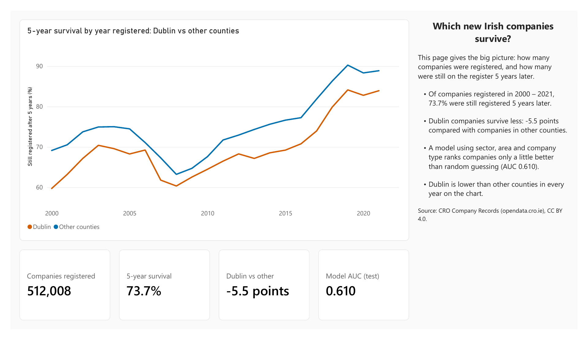
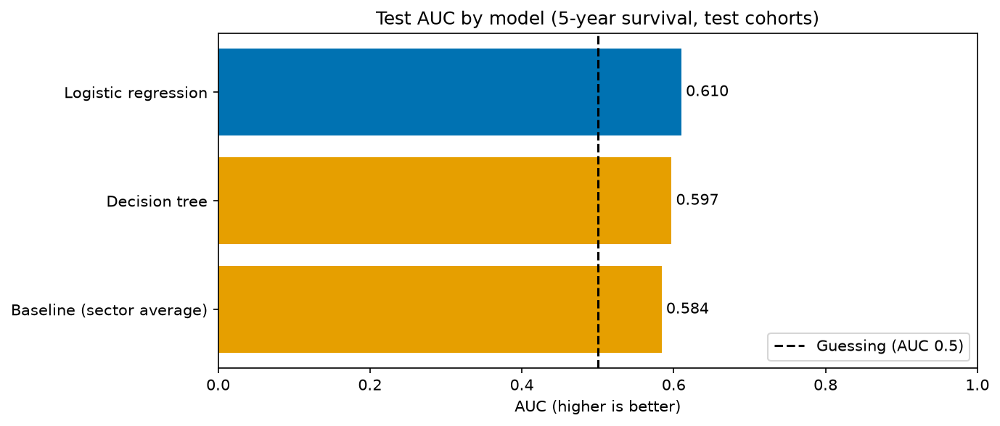
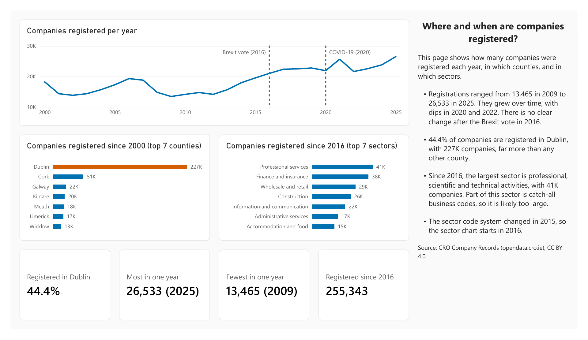
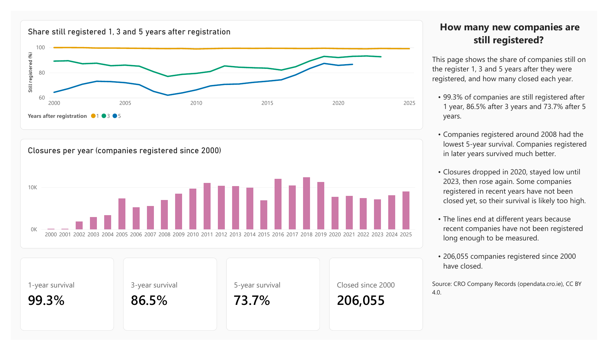
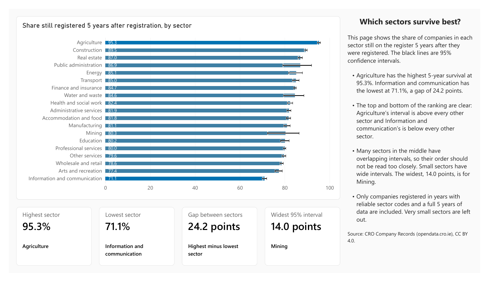
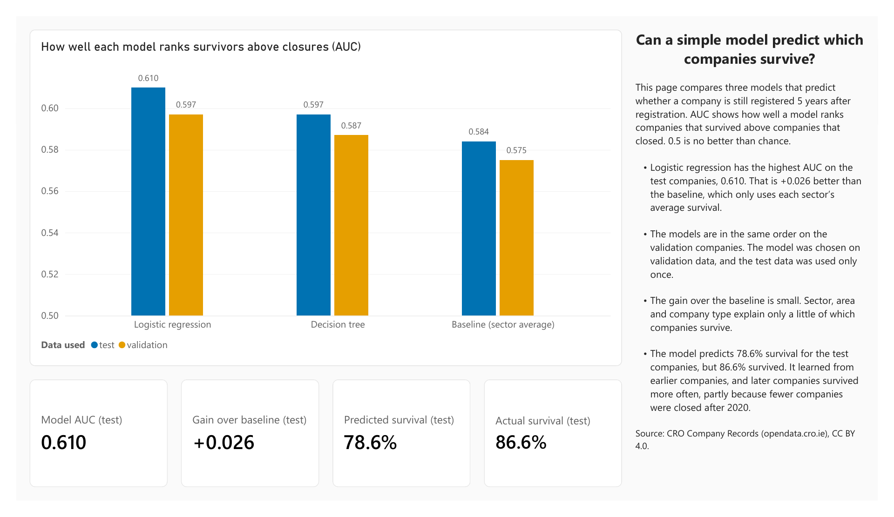

# Which new Irish companies survive?

How long do new Irish companies last? I used the public company register from the Companies Registration Office (CRO), with 512,008 companies registered from 2000 to October 2026. For each company, I checked if it was still registered 1, 3 and 5 years later. Then I compared the results by year, sector and county. Of the companies that were at least 5 years old, 73.7% were still registered.

I cleaned the data in Python, stored it in a SQL Server database, did the analysis in Python, built a simple model to predict which companies last 5 years, and made a five-page Power BI dashboard.

**Tools:** Python (pandas, NumPy, matplotlib, SciPy, statsmodels, scikit-learn), SQL Server (T-SQL), Power BI, Git



## Business questions

1. How many companies were registered each year, in which sectors and counties, and did registrations change after the Brexit vote (2016) or during COVID-19 (2020)?
2. What share of companies is still registered 1, 3 and 5 years after registration, and how has this changed for companies registered since 2000?
3. Which sectors have the highest and lowest 5-year survival, for companies registered from 2016 to 2020?
4. Do companies registered in Dublin survive longer than companies in other counties?
5. Can a simple model using sector, area and company type predict 5-year survival better than a baseline that uses only each sector's average survival?

## Key findings

| # | Finding | Evidence |
|---|---|---|
| 1 | **Registrations have grown since 2010, with no clear Brexit effect.** They fell to 13,465 in 2009 and reached 26,533 in 2025, the highest year. They dipped slightly in 2020. Dublin has 44.4% of all companies. | Yearly counts, checked against SQL (notebook 3, section 2) |
| 2 | **Almost every company survives its first year. 5-year survival is higher for recent cohorts, but part of the rise comes from late closures.** Across all cohorts, 99.3% were still registered after 1 year, 86.5% after 3 years and 73.7% after 5 years. 5-year survival was 62.0% for the 2008 cohort and 87.3% for 2019, which falls to 79.3% under the strict closed rule. Closures dropped in 2020 to 2023. In those years the CRO stopped removing companies that did not file their returns, because of COVID-19. After it started again, closures went up to 12,684 in 2026 (to October). | Survival rates with 95% Wilson intervals, closures per year, strict-rule sensitivity check (notebook 3, section 3), CRO stopping strike-offs (see Data sources) |
| 3 | **Agriculture has the highest 5-year survival and Information and communication the lowest.** For the 2016 to 2020 cohorts: 95.3% against 71.1%, a gap of 24.2 percentage points. The middle of the ranking overlaps. | 19 sectors with at least 100 companies, 95% Wilson intervals (notebook 3, section 4) |
| 4 | **Dublin companies survive less, not longer.** 70.7% of Dublin companies were still registered after 5 years, against 76.2% in other counties (gap -5.5 points, 95% CI -5.7 to -5.2). Dublin is lower in all 22 cohorts. | Newcombe interval, cohort-by-cohort comparison, direct standardisation for sector mix (-5.9 points), sensitivity checks (notebook 3, section 5) |
| 5 | **A simple model beats the baseline, but only by a small margin.** Logistic regression has a test AUC of 0.610, against 0.584 for the sector-average baseline (+0.026). Sector, area and company type predict survival only weakly. | Train 2016-2017, validation 2018, test 2019-2020; model chosen on validation (notebook 4) |

## Predicting 5-year survival

**Question:** can a company's sector, area (Dublin or other counties) and company type predict whether it is still registered 5 years after registration?

**How I tested it**
- **Data:** 109,888 companies from the 2016 to 2020 cohorts. These are the only years with the new sector codes and a full 5 years of data. 81.9% survived, so a model that says "survived" for every company would already be 81.9% accurate. That is why I use AUC (how well the model puts survivors above closed companies, where 0.5 is guessing and 1.0 is perfect) and Brier score (the average squared error of the predicted probability, where lower is better).
- **Split by registration year, not at random:** train on 2016-2017, validation on 2018, test on 2019-2020. Each model is always tested on companies registered after the ones it learned from, like it would be used in real life.
- **Three models:** a baseline that gives every company its sector's average survival, a logistic regression, and a decision tree with settings I chose before training (`max_depth = 4`, `min_samples_leaf = 200`).
- **One choice, one test:** I chose the model on the validation year. Then I trained all three again on 2016-2018 and tested them once on 2019-2020.

**Results**

| Model | Validation AUC | Test AUC | Test Brier |
|---|---|---|---|
| Logistic regression (chosen) | 0.597 | 0.610 | 0.121 |
| Decision tree | 0.587 | 0.597 | 0.121 |
| Baseline (sector average) | 0.575 | 0.584 | 0.121 |



**Takeaway:** the logistic regression beats the baseline on validation (+0.022) and on test (+0.026), so the gain holds on new years. But all three models are only a little better than guessing, because the CRO data has no information on company size, owners or money. All models predict about 78.6% survival for the test companies, but 86.6% really survived. This is because they learn from earlier years, when survival was lower. So the predictions are good for ranking companies, not as exact survival rates.

## Power BI dashboard

Five pages, built in Power BI Desktop (Import mode) from the SQL Server tables and the CSV files saved by notebooks 3 and 4. The numbers on the cards and charts are calculated from the data or read from the notebook outputs. The page notes repeat these numbers as text. In the `.pbix` file you can hover over a point or bar on pages 1, 3 and 4 to see how many companies are behind it, and hover over a county on page 2 to see its registrations per year.

| Page | Question | What it shows |
|---|---|---|
| 1 Overview | Which new Irish companies survive? | 5-year survival by cohort, Dublin vs other counties; key numbers from every page |
| 2 Registrations | Where and when are companies registered? | Registrations per year, top counties and top sectors |
| 3 Survival by cohort | How many new companies are still registered? | Survival by cohort and age, closures per year |
| 4 Sectors | Which sectors survive best? | 5-year survival by sector with 95% confidence intervals |
| 5 Model | Can a simple model predict which companies survive? | Validation and test AUC of the three models |

**Page 1: Overview**


**Page 2: Registrations**


**Page 3: Survival by cohort**


**Page 4: Sectors**


**Page 5: Model**


The full dashboard as a PDF: [irish_company_survival_dashboard.pdf](powerbi/irish_company_survival_dashboard.pdf)

## Repository structure

```
irish-company-survival-analysis/
├── data/
│   ├── README.md                      data dictionary for the processed CSV files
│   ├── raw/
│   │   └── companies.csv.zip          CRO Company Records, as downloaded
│   └── processed/
│       ├── companies_clean.csv        one row per company registered from 2000 (notebook 1)
│       ├── cohort_survival.csv        survival by cohort and age (notebook 3)
│       ├── sector_survival.csv        5-year survival by sector with 95% CIs (notebook 3)
│       ├── area_survival.csv          5-year survival by cohort, Dublin vs other counties (notebook 3)
│       └── model_results.csv          validation and test scores of the three models (notebook 4)
├── notebooks/
│   ├── 1_data_preparation.ipynb
│   ├── 2_sql_database.ipynb
│   ├── 3_statistical_analysis.ipynb
│   └── 4_survival_model.ipynb
├── sql/
│   ├── 00_create_database.sql
│   ├── 01_create_tables.sql
│   ├── 02_analysis_queries.sql
│   └── README.md                      schema, data dictionary and design decisions
├── powerbi/
│   ├── irish_company_survival_dashboard.pbix
│   ├── irish_company_survival_dashboard.pdf
│   └── okabe_ito_theme.json           colour-blind safe theme
├── figures/                           03_*.png, 04_*.png and dashboard_*.png
├── requirements.txt
└── README.md
```

## Data dictionary

The columns of the five processed CSV files are described in [data/README.md](data/README.md).

## How to run

1. **Clone the repo and set up Python** (Python 3.13, Git Bash on Windows):
   ```bash
   git clone https://github.com/temulenbd/irish-company-survival-analysis.git
   cd irish-company-survival-analysis
   python -m venv .venv
   source .venv/Scripts/activate
   pip install -r requirements.txt
   ```
2. **Prepare the data:** run `notebooks/1_data_preparation.ipynb`. It reads `data/raw/companies.csv.zip` directly, so there is no need to unzip it, and it writes `data/processed/companies_clean.csv`.
3. **Create the database:** in SQL Server Management Studio, run `sql/00_create_database.sql`, then `sql/01_create_tables.sql`. This uses SQL Server on `localhost` with Windows Authentication and ODBC Driver 18. The schema is described in [`sql/README.md`](sql/README.md).
4. **Load the tables:** run `notebooks/2_sql_database.ipynb`.
5. **Optional:** run `sql/02_analysis_queries.sql` in SSMS. Notebook 3 checks its results against these queries.
6. **Run the analysis:** run `notebooks/3_statistical_analysis.ipynb`, then `notebooks/4_survival_model.ipynb`. They write the figures and the CSV files for Power BI.
7. **Open the dashboard:** open `powerbi/irish_company_survival_dashboard.pbix`. If the file paths or server name differ on your computer, update them in Transform data → Data source settings, then click Refresh.

## Data sources

| Data | Source | Licence | Downloaded |
|---|---|---|---|
| Company Records (`companies.csv.zip`): one row per company registered in Ireland, including dissolved companies | [Companies Registration Office (CRO) open data](https://opendata.cro.ie/) | [CC BY 4.0](https://creativecommons.org/licenses/by/4.0/) | October 2026 |

Contains Irish Public Sector Data licensed under a Creative Commons Attribution 4.0 International (CC BY 4.0) licence.

**Background dates** (used for the reference lines in notebook 3):
- Brexit referendum, 23 June 2016: [Results of the 2016 UK EU membership referendum](https://en.wikipedia.org/wiki/Results_of_the_2016_United_Kingdom_European_Union_membership_referendum)
- First COVID-19 restrictions in Ireland, 12 March 2020: [gov.ie, "Updated measures in response to COVID-19 (Coronavirus), Thursday 12 March"](https://www.gov.ie/en/department-of-health/publications/updated-measures-in-response-to-covid-19-coronavirus-thursday-12-march/)
- CRO stopping strike-offs: [CRO letter, 12 May 2020](https://www.lawsociety.ie/globalassets/documents/news/covid19/letters/letter-from-cro-12-may.pdf) (strike-offs stopped since mid-March 2020) and [Law Society Gazette, September 2026](https://www.lawsociety.ie/gazette/top-stories/2026/september/automated-cro-enforcement-shifts-into-high-gear/) (the CRO is now catching up).

## Limitations

- **"Survived" means still on the register, not still trading.** A company that does nothing still counts as survived. Companies waiting to be struck off or in liquidation also count as survived, so in notebook 3 I repeat the analysis with a strict rule that counts them as closed.
- **Recent 5-year rates are probably too high.** Closures dropped in 2020 to 2023 and then went up a lot (12,684 in 2026, up to October). This fits with the CRO stopping strike-offs in March 2020 and catching up after it started again in 2025. A company removed late still counts as registered at its 5-year date.
- **Sector results cover the 2016 to 2020 cohorts only.** Before 2015, companies used an older sector code system, and the old and new codes cannot be compared without converting them. Companies also choose their own code, and many pick broad codes such as management consultancy, which makes Professional services look bigger.
- **County comes from the address text.** 1,822 companies have no county. Also, the registered address is not always where the business really works.
- **Some registration dates may be wrong.** When companies merge, the register may change the registration date. In notebook 1, I removed 29 companies that closed before their registration date.
- **The confidence intervals only cover chance differences,** not mistakes in the register.
- **The model has only three features.** The CRO data has no company size, owners, funding or accounts, so a low AUC is expected. I decided to choose the model by AUC only after I saw the validation scores. The Brier scores were the same for all models, so this did not change the choice. The predicted survival rates are too low, because survival went up between the training and test cohorts.
- **All numbers are from the October 2026 download.** A newer download will give slightly different numbers.

## About this project
This is an end-to-end portfolio project: raw CRO data, cleaning in Python, a SQL Server database, survival analysis, a simple model and a Power BI dashboard.

The data needed more checking than I expected, and some things I found changed my plan:
- **The same status was saved in two ways.** 323,502 companies had `Normal ` with a space at the end and 900 had `Normal`. I removed the spaces before deciding which statuses mean "closed".
- **Old records follow different rules.** The oldest registration date is 1753, and the status `Dissolved-20 years` is used for very old closures. It still appears up to 2000-2004, so I start in 2000 and check if the results change when I start in 2005.
- **The sector code system changed in 2015.** Older companies use different codes, so the sector analysis only uses the 2016 to 2020 cohorts.
- **29 companies closed before they were registered.** All of them left the register after a merger or a move abroad, and 28 have a registration date in 2020 or 2021, so the register probably changed the date. I can't measure how long they lasted, so I removed them.
- **"Still registered" is not the same as "still trading".** 17,045 companies are waiting to be struck off or in liquidation but have no closing date. Counting them as closed lowers 5-year survival by up to 9.4 points, so I show the results with both rules.
- **A company only counts at an age once it has reached it.** Without this rule, the youngest cohorts would look like they all survived.
- **The weak model is also a result.** With only sector, area and company type, the best model reaches an AUC of 0.610. All models predict too low for later cohorts, because survival went up over time.

**Author:** Temuulen Bulgan, MSc Data Analytics, BSc Statistics and Economics · [LinkedIn](https://www.linkedin.com/in/temulenbd/)
