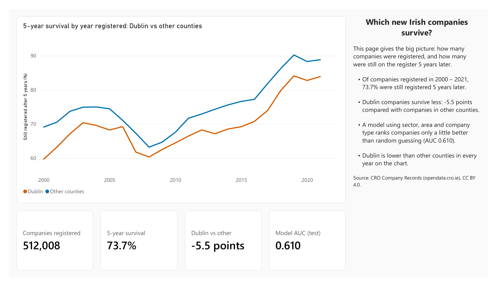
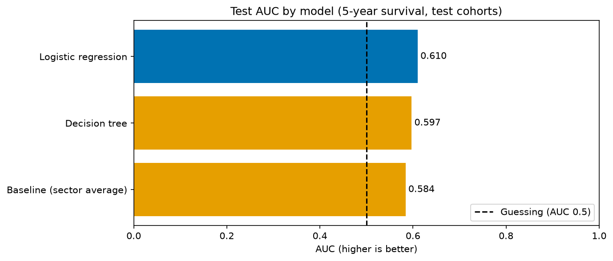
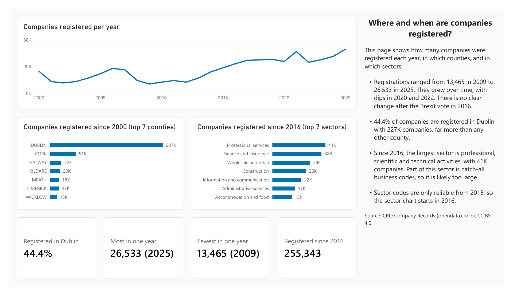
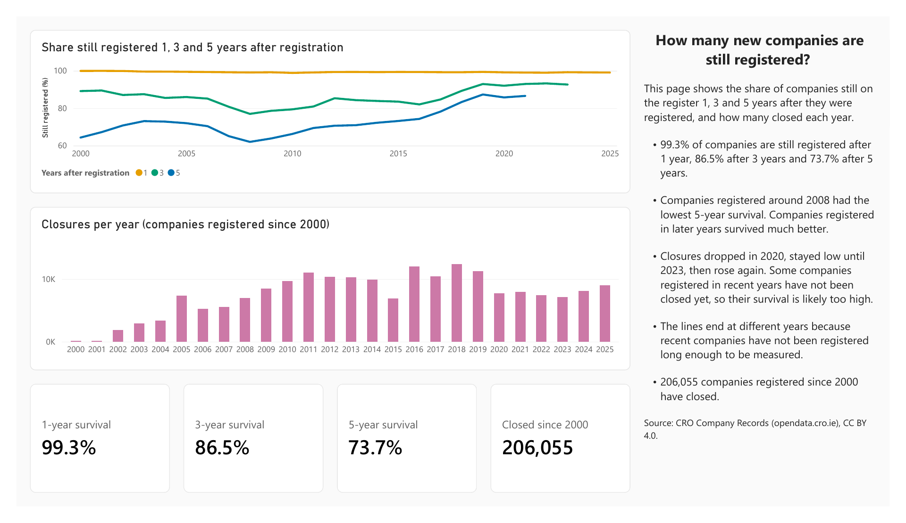
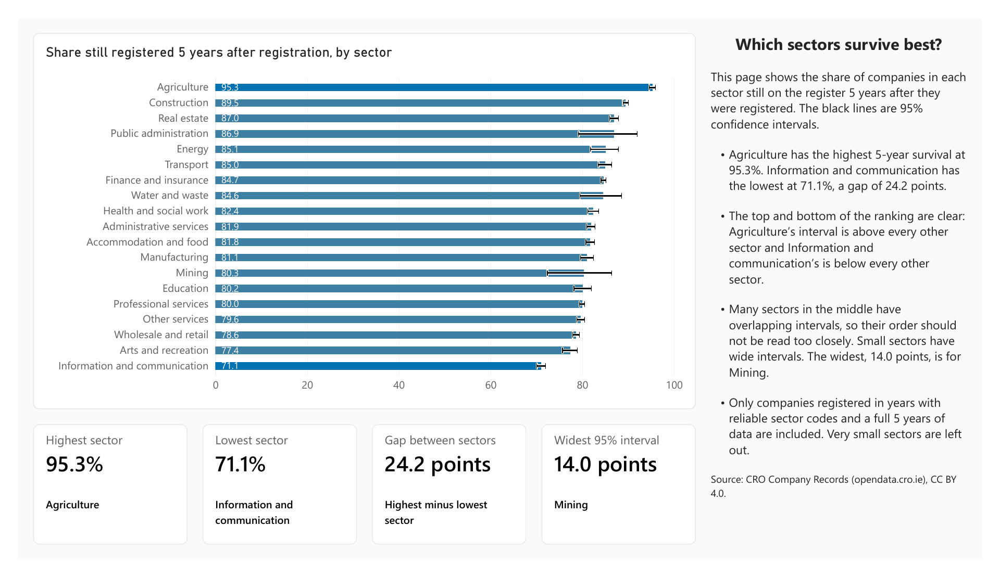
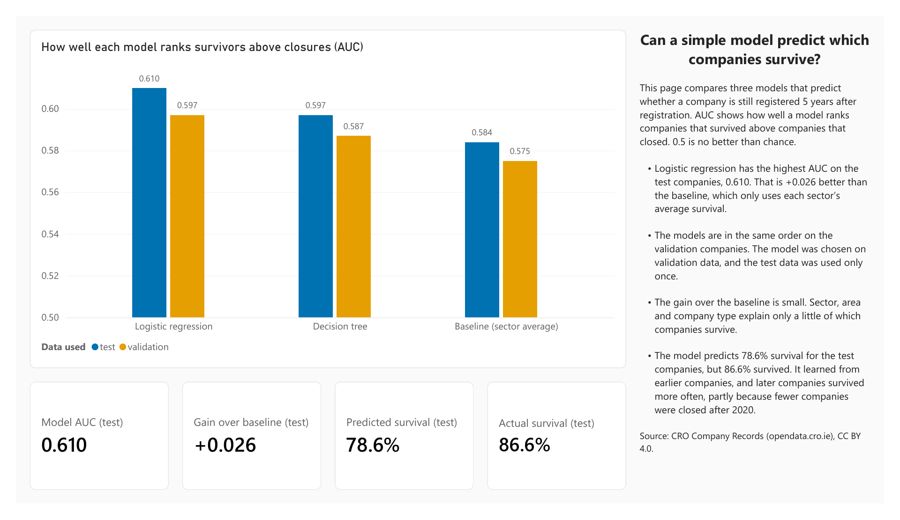

# Which new Irish companies survive?

An analysis of over 500k companies registered in Ireland since 2000, using open data from the Companies Registration Office (CRO). It covers data preparation in Python, a SQL Server database, survival analysis by cohort, sector and county, a model that predicts 5-year survival, and a five-page Power BI dashboard.

**Tools:** Python (pandas, NumPy, matplotlib, SciPy, statsmodels, scikit-learn), SQL Server (T-SQL), Power BI, Git



## Business questions

1. How many companies were registered each year, in which sectors and counties, and did registrations change after the Brexit vote (2016) or during COVID-19 (2020)?
2. What share of companies is still registered 1, 3 and 5 years after registration, and how has this changed for companies registered since 2000?
3. Which sectors have the highest and lowest 5-year survival, for companies registered from 2016 to 2020?
4. Do companies registered in Dublin survive longer than companies in other counties?
5. Can a simple model using sector, area and company type predict 5-year survival better than a baseline that uses only each sector's average survival?

## Key findings

| # | Finding | Evidence |
|---|---|---|
| 1 | **Registrations have grown since 2010, with no clear Brexit effect.** They fell to 13,465 in 2009 and reached 26,533 in 2025, the highest year. They dipped slightly in 2020. Dublin has 44.4% of all companies. | Yearly counts, checked against SQL (notebook 3, section 2) |
| 2 | **Almost every company survives its first year. 5-year survival is higher for recent cohorts, but part of the rise comes from late closures.** Across all cohorts, 99.3% were still registered after 1 year, 86.5% after 3 years and 73.7% after 5 years. 5-year survival was 62.0% for the 2008 cohort and 87.3% for 2019, which falls to 79.3% under the strict closed rule. | Survival rates with 95% Wilson intervals, closures per year, strict-rule sensitivity check (notebook 3, section 3) |
| 3 | **Agriculture has the highest 5-year survival and Information and communication the lowest.** For the 2016 to 2020 cohorts: 95.3% against 71.1%, a gap of 24.2 percentage points. The middle of the ranking overlaps. | 19 sectors with at least 100 companies, 95% Wilson intervals (notebook 3, section 4) |
| 4 | **Dublin companies survive less, not longer.** 70.7% of Dublin companies were still registered after 5 years, against 76.2% in other counties (gap -5.5 points, 95% CI -5.7 to -5.2). Dublin is lower in all 22 cohorts. | Newcombe interval, cohort-by-cohort comparison, direct standardisation for sector mix (-5.9 points), sensitivity checks (notebook 3, section 5) |
| 5 | **A simple model beats the baseline, but only by a small margin.** Logistic regression has a test AUC of 0.610, against 0.584 for the sector-average baseline (+0.026). Sector, area and company type predict survival only weakly. | Train 2016–2017, validation 2018, test 2019–2020; model chosen on validation (notebook 4) |

## Predicting 5-year survival

**Question:** can a company's sector, area (Dublin or other counties) and company type predict whether it is still registered 5 years after registration?

**How it was tested**
- **Data:** 109,888 companies from the 2016 to 2020 cohorts, the years with reliable sector codes and a full 5-year outcome. 81.9% survived, so accuracy would be misleading. The models are compared on AUC (how well they rank survivors above closures, where 0.5 is guessing) and Brier score (the average squared error of the predicted probability).
- **Split by registration year, not at random:** train on 2016–2017, validation on 2018, test on 2019–2020. Each model is always scored on companies registered after the ones it learned from.
- **Three models:** a baseline that gives every company its sector's average survival, a logistic regression, and a decision tree with settings fixed in advance (`max_depth = 4`, `min_samples_leaf = 200`).
- **One choice, one test:** the model was chosen on the validation cohort. All three were then refitted on 2016–2018 and scored once on the test cohorts.

**Results**

| Model | Validation AUC | Test AUC | Test Brier |
|---|---|---|---|
| Logistic regression (chosen) | 0.597 | 0.610 | 0.121 |
| Decision tree | 0.587 | 0.597 | 0.121 |
| Baseline (sector average) | 0.575 | 0.584 | 0.121 |



**Takeaway:** the logistic regression beats the baseline on both validation (+0.022) and test (+0.026), so the gain holds on new cohorts. But all three models rank companies only a little better than guessing: the CRO data has no size, owner or financial information. All models predict about 78.6% survival for the test companies, against 86.6% that survived, because they learn from earlier cohorts with lower survival. The predictions are useful for ranking companies, not as exact survival rates.

## Power BI dashboard

Five pages, built in Power BI Desktop (Import mode) from the SQL Server tables and the CSV files saved by notebooks 3 and 4. Every number on the dashboard comes from the data or the notebook outputs. None are typed.

| Page | Question | What it shows |
|---|---|---|
| 1 Overview | Which new Irish companies survive? | 5-year survival by cohort, Dublin vs other counties; key numbers from every page |
| 2 Registrations | Where and when are companies registered? | Registrations per year, top counties and top sectors |
| 3 Survival by cohort | How many new companies are still registered? | Survival by cohort and age, closures per year |
| 4 Sectors | Which sectors survive best? | 5-year survival by sector with 95% confidence intervals |
| 5 Model | Can a simple model predict which companies survive? | Validation and test AUC of the three models |

**Page 1: Overview**


**Page 2: Registrations**


**Page 3: Survival by cohort**


**Page 4: Sectors**


**Page 5: Model**


The full dashboard as a PDF: [irish_company_survival_dashboard.pdf](powerbi/irish_company_survival_dashboard.pdf)

## Repository structure

```
irish-company-survival-analysis/
├── data/
│   ├── raw/
│   │   └── companies.csv.zip          CRO Company Records, as downloaded
│   └── processed/
│       ├── companies_clean.csv        one row per company registered from 2000 (notebook 1)
│       ├── cohort_survival.csv        survival by cohort and age (notebook 3)
│       ├── sector_survival.csv        5-year survival by sector with 95% CIs (notebook 3)
│       ├── area_survival.csv          5-year survival by cohort, Dublin vs other counties (notebook 3)
│       └── model_results.csv          validation and test scores of the three models (notebook 4)
├── notebooks/
│   ├── 1_data_preparation.ipynb
│   ├── 2_sql_database.ipynb
│   ├── 3_statistical_analysis.ipynb
│   └── 4_survival_model.ipynb
├── sql/
│   ├── 00_create_database.sql
│   ├── 01_create_tables.sql
│   ├── 02_analysis_queries.sql
│   └── README.md                      schema, data dictionary and design decisions
├── powerbi/
│   ├── irish_company_survival_dashboard.pbix
│   ├── irish_company_survival_dashboard.pdf
│   └── okabe_ito_theme.json           colour-blind safe theme
├── figures/                           03_*.png, 04_*.png and dashboard_*.png
├── requirements.txt
└── README.md
```
## Data dictionary

### `companies_clean.csv` (512,008 rows, one per company registered from 2000)

| Column | Type | Description |
|---|---|---|
| `company_num` | integer | CRO company number (unique) |
| `reg_date` | date | Registration date |
| `company_type` | text | Private limited (LTD), Guarantee (CLG), DAC, Unlimited, Public (PLC), Other, Unknown |
| `status` | text | Status on the register, e.g. Normal, Dissolved, Strike Off Listed, Liquidation |
| `closed` | true/false | True when the company has a closing date (left the register) |
| `closed_date` | date | Date the company left the register; empty if still registered |
| `nace_code` | number | 4-digit NACE Rev. 2 sector code chosen by the company; empty for most companies registered before 2015 |
| `county` | text | County taken from the registered address (uppercase); empty for 1,822 companies |

### `cohort_survival.csv` (72 rows, one per cohort and age)

| Column | Description |
|---|---|
| `reg_year` | Registration year (cohort) |
| `years_after` | Age: 1, 3 or 5 years after registration |
| `eligible` | Companies old enough to be counted at that age by the data date |
| `survived` | Of those, companies still registered at that age |
| `survival_pct` | `survived` / `eligible` × 100 |

### `sector_survival.csv` (19 rows, one per sector with at least 100 companies, 2016 to 2020 cohorts)

| Column | Description |
|---|---|
| `section_name` | NACE section (first 2 digits of `nace_code`) |
| `eligible_5y` | Companies old enough for the 5-year rate |
| `survived_5y` | Of those, companies still registered after 5 years |
| `survival_5y_pct` | `survived_5y` / `eligible_5y` × 100 |
| `ci_low_pct`, `ci_high_pct` | 95% Wilson confidence interval |

### `area_survival.csv` (44 rows, one per cohort and area)

| Column | Description |
|---|---|
| `reg_year` | Registration year (cohort) |
| `area` | Dublin or Other counties |
| `eligible_5y`, `survived_5y`, `survival_5y_pct` | As in `sector_survival.csv` |

### `model_results.csv` (6 rows, one per model and set)

| Column | Description |
|---|---|
| `set` | validation (2018 cohort) or test (2019 and 2020 cohorts) |
| `model` | Baseline (sector average), Logistic regression or Decision tree |
| `auc` | Area under the ROC curve (0.5 = guessing, 1.0 = perfect) |
| `brier` | Brier score (lower is better) |
| `mean_predicted_pct` | Average predicted survival |
| `actual_pct` | Share of companies that survived |
| `auc_gain` | AUC minus the baseline AUC in the same set |
| `chosen` | True for the model chosen on the validation cohort |

## How to run

1. **Clone the repo and set up Python** (Python 3.13, Git Bash on Windows):
   ```bash
   git clone https://github.com/temulenbd/irish-company-survival-analysis.git
   cd irish-company-survival-analysis
   python -m venv .venv
   source .venv/Scripts/activate
   pip install -r requirements.txt
   ```
2. **Prepare the data:** run `notebooks/1_data_preparation.ipynb`. It reads `data/raw/companies.csv.zip` directly, so there is no need to unzip it, and it writes `data/processed/companies_clean.csv`.
3. **Create the database:** in SQL Server Management Studio, run `sql/00_create_database.sql`, then `sql/01_create_tables.sql`. This uses SQL Server on `localhost` with Windows Authentication and ODBC Driver 18. The schema is described in [`sql/README.md`](sql/README.md).
4. **Load the tables:** run `notebooks/2_sql_database.ipynb`.
5. **Optional:** run `sql/02_analysis_queries.sql` in SSMS. Notebook 3 checks its results against these queries.
6. **Run the analysis:** run `notebooks/3_statistical_analysis.ipynb`, then `notebooks/4_survival_model.ipynb`. They write the figures and the CSV files for Power BI.
7. **Open the dashboard:** open `powerbi/irish_company_survival_dashboard.pbix`. If the file paths or server name differ on your computer, update them in Transform data → Data source settings, then click Refresh.

## Data sources

| Data | Source | Licence | Downloaded |
|---|---|---|---|
| Company Records (`companies.csv.zip`): one row per company registered in Ireland, including dissolved companies | [Companies Registration Office (CRO) open data](https://opendata.cro.ie/) | [CC BY 4.0](https://creativecommons.org/licenses/by/4.0/) | October 2026 |

Contains Irish Public Sector Data licensed under a Creative Commons Attribution 4.0 International (CC BY 4.0) licence.

**Background dates** (used for the reference lines in notebook 3):
- Brexit referendum, 23 June 2016: [Results of the 2016 UK EU membership referendum](https://en.wikipedia.org/wiki/Results_of_the_2016_United_Kingdom_European_Union_membership_referendum)
- First COVID-19 restrictions in Ireland, 12 March 2020: [gov.ie, "Updated measures in response to COVID-19 (Coronavirus), Thursday 12 March"](https://www.gov.ie/en/department-of-health/publications/updated-measures-in-response-to-covid-19-coronavirus-thursday-12-march/)

## Limitations

- **"Survived" means still on the register, not still trading.** Dormant companies count as survived. Companies listed for strike-off or in liquidation also count as survived, so notebook 3 repeats the analysis with a strict rule that counts them as closed.
- **Recent 5-year rates are probably too high.** Closures fell in 2020 to 2023 and then rose sharply (12,684 in 2026 up to October). Companies removed from the register late still count as registered at their 5-year date.
- **Sector results cover the 2016 to 2020 cohorts only.** Sector codes are mostly missing before 2015. Companies choose their own code, and broad codes such as management consultancy make Professional services larger.
- **County comes from the registered address text.** 1,822 companies have no county, and a registered office is not always where the business operates.
- **Some registration dates may be wrong.** Companies that merged may have an overwritten registration date. 29 companies with a closing date before their registration date were removed in notebook 1.
- **The confidence intervals cover random variation only,** not errors in the register.
- **The model has only three features.** Size, owners, funding and accounts are not in the CRO data, so a low AUC is expected. The rule to choose the model on AUC was stated after the validation scores were seen. The Brier scores were tied, so the choice would not change. The predicted probabilities are too low as absolute rates, because survival rose between the training and test cohorts.
- **All counts match the October 2026 download.** A newer download will give slightly different numbers.

## About this project
An end-to-end portfolio project covering the full analytics workflow: public raw data, cleaning and quality checks in Python, a SQL Server database, survival analysis, a predictive model and a Power BI dashboard.

The methods were chosen to avoid common mistakes in survival and prediction work:
- A company is counted at an age only once it has reached that age by the data date, so recent cohorts are not counted as survivors too early.
- Every 5-year survival rate has a 95% confidence interval (Wilson; Newcombe for the Dublin gap), so differences caused by small samples are not over-read.
- The Dublin gap is tested cohort by cohort and with the same sector mix (direct standardisation), so it is not caused by a different mix of years or sectors.
- Key results are repeated under a stricter closed rule and a later start year, so they do not depend on one definition.
- The model is trained on earlier cohorts and tested on later ones, with settings fixed in advance and the test data used once. It is compared with a simple sector-average baseline.
- The model is scored on AUC and Brier score, not accuracy, because 81.9% of companies survived.

**Author:** Temuulen Bulgan