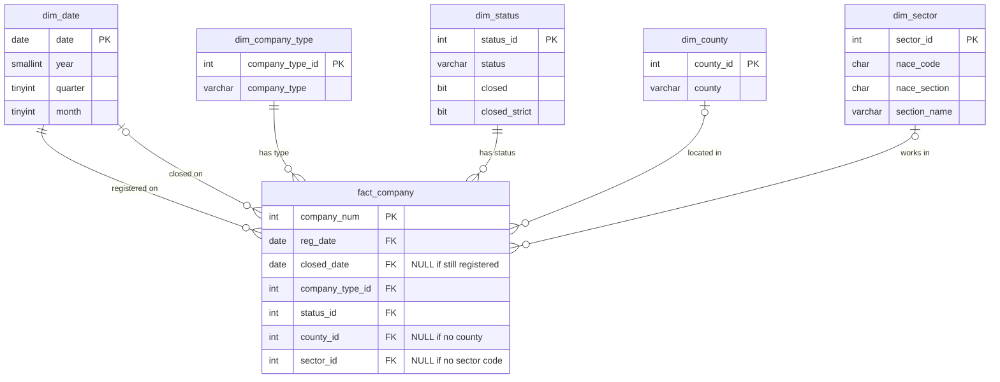

# SQL database

This folder builds the SQL Server database for the project and holds the analysis queries.
The database `irish_company_survival` is a star schema: one fact table with one row per company,
and five small dimension tables for dates, company types, counties, sectors and statuses.

## Files

| File | What it does | Run order |
|---|---|---|
| `00_create_database.sql` | Creates the database `irish_company_survival` if it does not exist | 1 |
| `01_create_tables.sql` | Drops and recreates the six empty tables, with primary and foreign keys | 2 |
| `../notebooks/2_sql_database.ipynb` | Loads the tables from `data/processed/companies_clean.csv` and checks row counts in SQL | 3 |
| `02_analysis_queries.sql` | Nine queries that answer business questions 1 to 4 | 4 |

## Star schema

