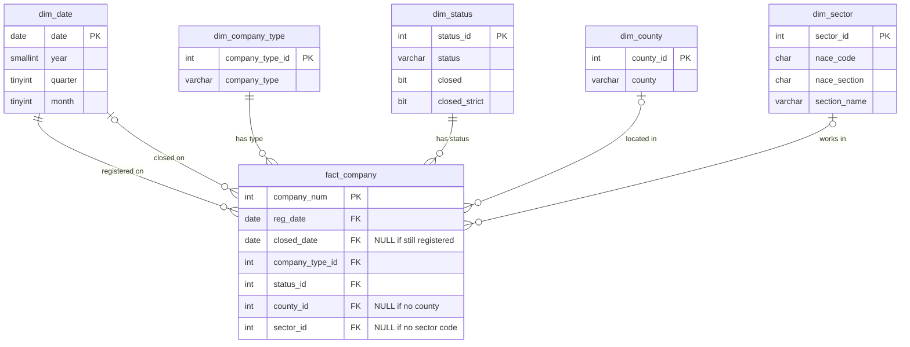

# SQL database

This folder builds the SQL Server database for the project and holds the analysis queries.
The database `irish_company_survival` is a star schema: one fact table with one row per company,
and five small dimension tables for dates, company types, counties, sectors and statuses.

## Files

| File | What it does | Run order |
|---|---|---|
| `00_create_database.sql` | Creates the database `irish_company_survival` if it does not exist | 1 |
| `01_create_tables.sql` | Drops and recreates the six empty tables, with primary and foreign keys | 2 |
| `../notebooks/2_sql_database.ipynb` | Loads the tables from `data/processed/companies_clean.csv` and checks row counts in SQL | 3 |
| `02_analysis_queries.sql` | Nine queries that answer business questions 1 to 4 | 4 |

## Star schema

## Data dictionary

### fact_company (512,008 rows, one row per company registered from 2000)

| Column | Type | Description |
|---|---|---|
| `company_num` | INT, PK | CRO company number |
| `reg_date` | DATE, FK → `dim_date` | Registration date |
| `closed_date` | DATE, FK → `dim_date`, NULL | Date the company left the register. NULL if still registered |
| `company_type_id` | INT, FK → `dim_company_type` | Company type |
| `status_id` | INT, FK → `dim_status` | CRO status on the download date |
| `county_id` | INT, FK → `dim_county`, NULL | County from the registered address. NULL if no county was found |
| `sector_id` | INT, FK → `dim_sector`, NULL | Sector code. NULL if the company has no code |

### dim_date (9,797 rows, one row per day)

| Column | Type | Description |
|---|---|---|
| `[date]` | DATE, PK | Calendar day, from the first registration date to the last date in the data |
| `[year]` | SMALLINT | Year |
| `[quarter]` | TINYINT | Quarter, 1 to 4 |
| `[month]` | TINYINT | Month, 1 to 12 |

### dim_company_type (7 rows)

| Column | Type | Description |
|---|---|---|
| `company_type_id` | INT, PK | ID from 1, in alphabetical order |
| `company_type` | VARCHAR(50) | DAC, Guarantee (CLG), Other, Private limited (LTD), Public (PLC), Unknown, Unlimited |

### dim_county (26 rows)

| Column | Type | Description |
|---|---|---|
| `county_id` | INT, PK | ID from 1, in alphabetical order |
| `county` | VARCHAR(20) | County name in capitals, e.g. `DUBLIN` |

### dim_status (20 rows)

| Column | Type | Description |
|---|---|---|
| `status_id` | INT, PK | ID from 1, in alphabetical order |
| `status` | VARCHAR(50) | CRO status, e.g. `Normal`, `Dissolved` |
| `closed` | BIT | 1 if the status means the company has left the register (14 statuses) |
| `closed_strict` | BIT | 1 for the same statuses plus `Liquidation` and `Strike Off Listed` (16 statuses). Used as a sensitivity check |

### dim_sector (581 rows, one row per 4-digit NACE code)

| Column | Type | Description |
|---|---|---|
| `sector_id` | INT, PK | ID from 1, in code order |
| `nace_code` | CHAR(4) | 4-digit NACE Rev 2 code, e.g. `7022` |
| `nace_section` | CHAR(1) | NACE Rev 2 section letter, A to U, from the first two digits of the code |
| `section_name` | VARCHAR(50) | Short section name used in this project (see below) |

Short and official NACE Rev 2 section names:

| Section | Divisions | Short name | Official name |
|---|---|---|---|
| A | 01–03 | Agriculture | Agriculture, forestry and fishing |
| B | 05–09 | Mining | Mining and quarrying |
| C | 10–33 | Manufacturing | Manufacturing |
| D | 35 | Energy | Electricity, gas, steam and air conditioning supply |
| E | 36–39 | Water and waste | Water supply; sewerage, waste management and remediation activities |
| F | 41–43 | Construction | Construction |
| G | 45–47 | Wholesale and retail | Wholesale and retail trade; repair of motor vehicles and motorcycles |
| H | 49–53 | Transport | Transportation and storage |
| I | 55–56 | Accommodation and food | Accommodation and food service activities |
| J | 58–63 | Information and communication | Information and communication |
| K | 64–66 | Finance and insurance | Financial and insurance activities |
| L | 68 | Real estate | Real estate activities |
| M | 69–75 | Professional services | Professional, scientific and technical activities |
| N | 77–82 | Administrative services | Administrative and support service activities |
| O | 84 | Public administration | Public administration and defence; compulsory social security |
| P | 85 | Education | Education |
| Q | 86–88 | Health and social work | Human health and social work activities |
| R | 90–93 | Arts and recreation | Arts, entertainment and recreation |
| S | 94–96 | Other services | Other service activities |
| T | 97–98 | Households | Activities of households as employers and for own use |
| U | 99 | Extraterritorial bodies | Activities of extraterritorial organisations and bodies |

## Design decisions

| Decision | Reason |
|---|---|
| One row per company in `fact_company` | Each company is registered once and closes at most once. Survival is a question about companies, so the company is the natural grain |
| One `dim_date` for both dates | `reg_date` and `closed_date` both link to the same calendar, so year filters work the same way for registrations and closures |
| Missing county or sector stored as NULL | The company stays in the fact table. Counts of all companies use LEFT JOIN; rankings by county or sector use an inner JOIN and leave these companies out |
| Survival is not stored in a column | Survival depends on the data date. The queries calculate it from `reg_date`, `closed_date` and the last date in `dim_date`, so the results update when newer data is loaded |
| Censoring | A company counts for k-year survival only if its k-th anniversary is on or before the last date in `dim_date`. Younger companies are left out, so recent cohorts are not shown as surviving before they have had the time to close |
| Plain integer IDs from 1 | Simple keys, built and loaded by notebook 2 |
| Two closed flags in `dim_status` | `closed` is the main rule; `closed_strict` allows a sensitivity check on companies that are on their way off the register |

## Analysis queries (`02_analysis_queries.sql`)

| Query | What it shows | Business question |
|---|---|---|
| 1.1 | New companies registered each year | 1 |
| 1.2 | Change in registrations from the previous year (`LAG`) | 1 |
| 1.3 | New companies registered by county | 1 |
| 1.4 | New companies registered by sector, from 2016 | 1 |
| 2.1 | Share of companies still registered 1, 3 and 5 years after registration, per cohort | 2 |
| 2.2 | Companies closed each year | 2 |
| 3.1 | 5-year survival by sector, companies registered 2016 to 2020 | 3 |
| 4.1 | 5-year survival, Dublin compared with all other counties | 4 |
| 4.2 | The same comparison per cohort | 4 |

Business question 5 (predicting 5-year survival) is answered in `notebooks/4_*.ipynb`, not in SQL.

## How to rebuild the database

Requirements: SQL Server (localhost, Windows Authentication), SSMS, ODBC Driver 18 for SQL Server,
and the project's Python environment (`requirements.txt`).

1. Download the "Company Records" file from the CRO open data portal (https://opendata.cro.ie) and save it as `data/raw/companies.csv.zip`. The data files are not in this repository because they are too large for GitHub.
2. Run `notebooks/1_data_preparation.ipynb` to create `data/processed/companies_clean.csv`.
3. In SSMS, open and run `sql/00_create_database.sql` (F5).
4. Open and run `sql/01_create_tables.sql`. This drops and recreates all six tables, so any loaded data is lost.
5. Run `notebooks/2_sql_database.ipynb`. It clears and loads the tables and prints the row counts from SQL.
   Expected: `fact_company` 512,008 rows, `dim_date` 9,797, `dim_company_type` 7, `dim_county` 26, `dim_sector` 581, `dim_status` 20.
6. Open `sql/02_analysis_queries.sql`, select one query and press F5 to run it.